# WeighTrace · 秤迹



**A direct Bluetooth client for AFU-WL scales · iPhone / iPad / Mac**

English | [简体中文](README.md)

Have an `AFU-WL-TZ-A1` scale and want to weigh yourself without the vendor app? WeighTrace connects directly to this verified model over Bluetooth, reads weight and both ADC channels, and saves measurements locally without a vendor account. iPhone/iPad offer optional Apple Health integration; Mac can measure and record independently.

After weighing, follow your trends, back up your records, and compare both local ADC estimates with Afu reference results.

[Download the Mac test build](https://github.com/Xuan-lprk/smart-body-scale/releases) · [Mac installation guide](docs/MAC_INSTALL.md) (Chinese) · [Changelog](docs/CHANGELOG.md) (Chinese) · [Report an issue](https://github.com/Xuan-lprk/smart-body-scale/issues)

> **Check your model first: the currently verified device is `AFU-WL-TZ-A1` (the one sold for one cent).** Not every Ant Afu, Welland, or other brand scale can connect. Weight is measured by the scale; body composition is estimated locally, may differ from the vendor app, and is not intended for medical decisions.

## Download and Install

| Device | Installation | Apple Health |
|---|---|---|
| Mac: macOS 15.6+, Apple silicon or Intel | Open [Releases](https://github.com/Xuan-lprk/smart-body-scale/releases), expand **Assets**, and download `AFU-Scale-Mac-…-test.dmg` | Not available; history stays on the Mac |
| iPhone / iPad: iOS / iPadOS 18.6+ | Currently requires building with Xcode on a Mac; see [Building from Source](#building-from-source) | Optional read/write access |
| Android | No app yet; I may port it if there is interest | Not applicable |

Mac users **do not need Xcode or a developer account**. Download the `.dmg` installer, not the `Source code (zip)` shown on the page. See the [Mac installation guide](docs/MAC_INSTALL.md).

The app is named WeighTrace (秤迹). DMG filenames retain the `AFU-Scale-Mac-` prefix for compatibility with older update checkers.

1. Open the DMG and drag “WeighTrace” into Applications.
2. Launch it from Applications. The test build is not notarized by Apple. If macOS blocks it, verify the source and follow the system's Privacy & Security instructions. Do not disable system security protections; if macOS reports malware, stop and contact the publisher.
3. Allow Bluetooth, quit other apps/devices connected to the scale, wake the scale, and select it in the app.

There is currently no App Store or TestFlight installation option. If building the iPhone/iPad version yourself is inconvenient, you can watch the repository for future releases or use the official client.

## Your First Measurement

1. Enter your height, birth date, and sex, which affect BMI and composition estimates.
2. Place the scale on a hard, level floor. Stand barefoot and wait for both weight and impedance acquisition to finish.
3. Review the result and keep or delete it. Use consistent conditions and the same ADC for long-term trends.
4. Save a JSON backup under the profile's backup/export section. **Local history is not an automatic cloud backup**, and Mac and iPhone records do not sync automatically.

If the scale is missing, check Bluetooth permission, wake the scale, and make sure the vendor app, another device, or the CLI is not occupying its connection. More checks are listed under [Building from Source](#building-from-source).

## What You Can Do

- **Track daily measurements:** live weight, result review, household members, and trends.
- **Compare estimates:** preserve both ADCs and compare them with manually entered or locally OCR-extracted Afu references.
- **Keep control of your records:** JSON backup/restore, CSV export, and optional Apple Health integration with source and possible-duplicate inspection on iPhone/iPad.
- **Try measurement tools:** repeatability checks, animated history playback, and assisted weighing for pets or luggage. Assisted weights are rough differences between two readings, not a replacement for a dedicated scale.

See the detailed feature list and linked guides below. The project is still evolving; a successful build is not a substitute for release-specific hardware and cross-device testing.

## Project and Credits

> This project is based on community reverse-engineering research and is not affiliated with or authorized by Ant Afu, Welland, Fitdays, Icomon, or Apple.

This fork is based on [maoziban/smart-body-scale-IOS](https://github.com/maoziban/smart-body-scale-IOS) and preserves the original repository's Git history. It adds HealthKit writes, ADC selection, more reliable advertisement parsing, device identity binding, and clearer algorithm and privacy documentation.

## Current Features

- Scans for and connects to the verified `AFU-WL-TZ-A1` device with `subtype=7`.
- Displays live weight and saves one local record after the measurement stabilizes.
- Preserves both ADC values sent by the scale and lets you select ADC 1 or ADC 2 for estimation.
- Estimates body fat from weight and impedance, then displays additional metrics derived proportionally from body fat.
- Supports a personal profile, household member matching, and local measurement history.
- Trends filter by member, 30/90 days or all time, and weight/body fat/BMI, with raw readings, daily weight medians, and a 7-day trend.
- Full JSON backup and merge restoration with conflict previews, plus CSV analysis export. See [Trends and Backup](docs/TRENDS_BACKUP.md) (Chinese).
- Three-reading repeatability checks, per-member ADC difference charts, customizable home metrics, measurement tags and notes. See [Measurement Tools](docs/MEASUREMENT_TOOLS.md) (Chinese).
- Animated history playback and separate assisted-weighing records for pets, luggage, or parcels. See [Playback and Assisted Weighing](docs/PLAYBACK_ASSISTED.md) (Chinese).
- Supports foreground Bluetooth measurements on iPhone, iPad, and Mac through Mac Catalyst.
- On iPhone and iPad, optionally writes the following data to Apple Health:
  - Weight
  - BMI
  - Body fat percentage
  - Lean body mass
- On iPhone and iPad, reads body measurement records from the past year in Apple Health and identifies their source apps.
- Flags potentially duplicate weights written by different apps within a short period, without deleting anything automatically.
- Contains no accounts, ads, or third-party analytics SDKs. Optional Mac update checks contact GitHub without uploading measurements.
- Supports Simplified Chinese and English and automatically follows the system language.

## Where the Data Comes From

| Data | Source | Meaning |
|---|---|---|
| Weight | Measured directly by the scale | Parsed from BLE packets |
| ADC 1 / ADC 2 | Sent directly by the scale | Their exact physical meaning has not been fully confirmed |
| Impedance | Protocol conversion | Derived from the selected ADC value |
| BMI | Calculated locally | Weight divided by height squared |
| Body fat percentage | Estimated locally with a BIA formula | Not an official body fat field returned by the scale |
| Water, muscle, bone mass, protein, and subcutaneous fat | Roughly derived locally | Must not be treated as independent measurements |

The current primary BIA formula is based on the body composition estimation equations published by Segal et al. in 1988. The study population consisted mainly of adults, so results for children and adolescents require particular caution. When no valid impedance is available, the app falls back to an estimate based on BMI, age, and sex.

Formula references:

- Segal KR et al. (1988), [Lean body mass estimation by bioelectrical impedance analysis: a four-site cross-validation study](https://pubmed.ncbi.nlm.nih.gov/3337041/)
- Deurenberg P et al. (1991), [Body mass index as a measure of body fatness: age- and sex-specific prediction formulas](https://doi.org/10.1079/BJN19910073)

## Accuracy and Limitations

Weight is measured directly by the scale, and the ADC values are sent directly by the scale. Impedance is derived through protocol conversion. Body fat, water, muscle, bone mass, and other body composition values are local formula estimates and must not replace medical examinations.

ADC comparisons show differences between the two local estimates and Afu reference results. Closer agreement with the official result does not establish greater accuracy against true body fat. Do not select an ADC based on a single result or treat comparison statistics as medical validation.

For long-term trend tracking, use the same ADC consistently and measure under similar conditions.

## Verified Hardware

- Advertisement name: `AFU-WL-TZ-A1`
- Category: `2`
- Subtype: `7`
- Service: `FFB0`
- Notify characteristic: `FFB2`

Other models and firmware versions may use different advertisements or packet formats. See the [protocol notes](docs/PROTOCOL.md) for detailed reverse-engineering findings.

## Development Requirements

- Xcode 26.4 or later
- iOS / iPadOS 18.6 or later
- The current Mac Catalyst deployment target maps to macOS 15.6 or later
- A physical iPhone, iPad, or Mac with Bluetooth Low Energy support
- A personal or paid Apple Developer team with HealthKit enabled if you want to write to Apple Health

The simulator can be used to compile the project and inspect the interface, but it cannot perform real Bluetooth measurements.

## Building from Source

1. Clone the repository and open `体脂秤.xcodeproj`.
2. Select the app target and choose your own team under **Signing & Capabilities**.
3. If necessary, change the Bundle Identifier to a unique identifier that you own.
4. Select a connected iPhone/iPad, or select **My Mac (Mac Catalyst)**, and run the app.
5. Fully quit Ant Afu on other devices. If the scale is still occupied, turn off Bluetooth on those devices. Do not turn off Bluetooth on the device running this app.
6. Step onto the scale barefoot to wake it, then select the discovered device on the pairing screen.

If the scale does not appear, check the following:

- Bluetooth access is enabled for this app in system settings.
- The vendor app, another phone, and the desktop CLI are not connected to the scale.
- The scale's display is on and the scale is close to the device.
- The advertisement name and subtype match the verified hardware listed above.

## Apple Health

Apple Health features are shown only on iPhone and iPad. The Mac version does not support HealthKit access; measurements are stored only in the Mac app's local history.

Open **Profile → Apple Health** to enable synchronization and select the metrics to write. The app automatically writes only new live measurements assigned to the primary user. It does not upload existing history or household member records in bulk.

Weight is a direct measurement. BMI, body fat percentage, and lean body mass include local calculations. HealthKit samples contain metadata such as the algorithm version, impedance, and ADC index for future traceability.

Open **Profile → Cross-Scale Data** to authorize reading weight, BMI, body fat percentage, and lean body mass and to see which app created each record. A record is considered a possible duplicate when different sources write weights within five minutes and the values differ by no more than 0.1 kg. Detection is informational only and never modifies Apple Health data.

## Privacy

All profile and history data is stored in the app sandbox and measurement data is not uploaded. Mac update checks access only GitHub's public release information. When Apple Health integration is enabled, selected data is passed to HealthKit; whether it syncs through iCloud depends on the user's system settings. See [PRIVACY.md](docs/PRIVACY.md) for the complete statement.

Run `bash scripts/package-mac.sh` to create a local test DMG in `dist/`. Friends do not need Xcode. See [MAC_INSTALL.md](docs/MAC_INSTALL.md). The app can check for updates and open the download page, but updates must still be installed manually.

An Android app has not been implemented. The proposed BLE, local-storage, and optional Health Connect approach is documented in [ANDROID_PORT.md](docs/ANDROID_PORT.md).

## Project Structure

```text
体脂秤/
├── App/                    # App entry point and root view
├── Models/                 # Measurement, member, and ADC comparison models
├── Services/               # Bluetooth, HealthKit, profiles, algorithms, and OCR
├── Views/                  # SwiftUI feature screens and shared components
├── Assets.xcassets/        # App icons and color assets
├── 体脂秤.entitlements      # iOS/iPadOS HealthKit entitlement
└── 体脂秤Mac.entitlements   # macOS Bluetooth sandbox entitlement
docs/
├── ANDROID_PORT.md         # Proposed Android implementation
├── CHANGELOG.md            # Changelog
├── PRIVACY.md              # Privacy statement
└── PROTOCOL.md             # AFU-WL reverse-engineering notes
```

## Build Check

```bash
xcodebuild \
  -project "体脂秤.xcodeproj" \
  -scheme "体脂秤" \
  -destination "generic/platform=iOS Simulator" \
  CODE_SIGNING_ALLOWED=NO \
  build
```

Unsigned Mac Catalyst build:

```bash
xcodebuild \
  -project "体脂秤.xcodeproj" \
  -scheme "体脂秤" \
  -destination "generic/platform=macOS,variant=Mac Catalyst" \
  CODE_SIGNING_ALLOWED=NO \
  build
```

GitHub Actions runs the same unsigned build on every push and pull request.

## Contributing

Compatibility fixes and sanitized protocol samples are welcome. Please avoid:

- Committing real health data, device UUIDs, or Apple Developer team information.
- Describing estimated metrics as medical measurements.
- Changing production formulas or the default ADC without comparison data.

## License

This fork was created with permission from the upstream author and is released under the [GNU General Public License v3.0](LICENSE).
